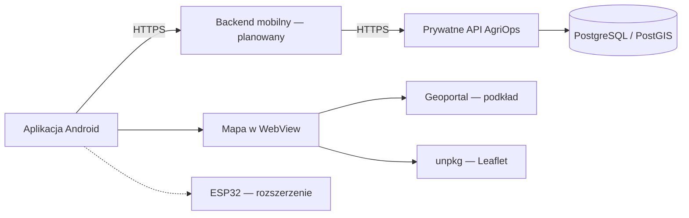

# AgriOps Mobile

Projekt na zajęcia Bezpieczeństwo Aplikacji i Systemów Mobilnych. Poniżej znajduje się karta projektu i aktualny stan aplikacji.

## Informacje o projekcie

| Pole | Wartość |
| --- | --- |
| Nazwa aplikacji | AgriOps Mobile |
| Zespół | Wojciech Kierat, Błażej Sztefka |
| Platforma | Android; telefon właściciela i tablet w ciągniku |
| Technologia aplikacji | React Native, TypeScript, Expo z własnym buildem deweloperskim |
| Backend | Docelowo osobny backend mobilny ASP.NET Core połączony z prywatnym API AgriOps |
| Baza danych | PostgreSQL / PostGIS po stronie AgriOps |
| Repozytorium | [Kieratw/agriops-mobile](https://github.com/Kieratw/agriops-mobile) |

## 1. Koncepcja aplikacji

AgriOps Mobile służy do przeglądania pól, zapisywania zdjęć z lokalizacją i rejestrowania punktów pobrania próbek gleby. Właściciel planuje proste prace terenowe, a tablet w ciągniku pokazuje przypisane zadania i pozwala zgłosić ich wykonanie. Dane trafiają przez backend mobilny do AgriOps; ręczny zapis próbek pozwala korzystać z aplikacji bez gotowego ESP32.

Aplikacja jest przeznaczona dla właściciela gospodarstwa i osoby korzystającej z przypisanego terminala w ciągniku. Projekt nie obejmuje ewidencji pracowników.

MVP obejmuje jeden rodzaj zlecenia: uprawę gleby, np. przejazd agregatem. Właściciel wybiera pole, termin, ciągnik i narzędzie. Terminal rejestruje rozpoczęcie, zakończenie oraz raport z czasem, powierzchnią i ewentualną uwagą; właściciel zatwierdza wykonanie.

ESP32 jest rozszerzeniem po uruchomieniu ręcznej rejestracji próbek. Punkt GPS oznacza miejsce pobrania próbki, a wynik badania gleby jest osobną daną.

Do obserwacji pola można będzie zrobić nowe zdjęcie kamerą albo wybrać istniejące z galerii. Lokalizacja obserwacji będzie zapisywana osobno, z rozróżnieniem aktualnego GPS i punktu wskazanego ręcznie.

## 2. Role użytkowników

| Rola | Co może | Czego nie może |
| --- | --- | --- |
| Właściciel | Przeglądać dane swoich gospodarstw, planować zlecenia, parować i odłączać terminale, przeglądać zdjęcia i próbki oraz zatwierdzać raporty prac. | Odczytywać ani zmieniać danych cudzych gospodarstw. |
| Terminal ciągnika | Po sparowaniu odczytywać przydzielone pola i zadania, rejestrować przebieg pracy oraz dodawać zdjęcia, lokalizacje i punkty próbek w dozwolonym zakresie. | Zarządzać dostępem, tworzyć i edytować pól, zatwierdzać własnych raportów ani pobierać danych innych gospodarstw lub nieprzydzielonych zadań. |

Terminal otrzymuje własną sesję, którą właściciel może odwołać. Zakres dostępu sprawdza serwer przy każdym żądaniu. W obecnym szkielecie wybór Właściciel / Ciągnik przełącza tylko ekran; pełne role i parowanie są planowane.

## 3. Dane i ich klasyfikacja

| Dane | Źródło | Przechowywanie docelowe | Klasyfikacja | Uzasadnienie |
| --- | --- | --- | --- | --- |
| E-mail i identyfikator konta | Logowanie | Backend; w aplikacji tylko potrzebne dane sesji | Poufne | Pozwalają powiązać dane z użytkownikiem. |
| Tokeny sesji | Backend mobilny | Chroniony magazyn systemowy telefonu lub tabletu; backend obsługuje ważność i odwołanie sesji | Poufne | Umożliwiają dostęp do konta lub terminala. |
| Jednorazowy kod parowania QR | Właściciel i backend mobilny | Backend i chwilowo urządzenia podczas parowania | Poufne | Pozwala przypisać terminal do gospodarstwa; musi wygasać i być jednorazowy. |
| Pola, uprawy i przypisanie próbek | AgriOps i formularze aplikacji | AgriOps; na urządzeniu tylko dane potrzebne do pracy | Wewnętrzne | Opisują gospodarstwo i jego działalność. |
| Zlecenia i raporty prac | Właściciel i terminal | Backend; lokalnie szkic niezakończonej pracy | Wewnętrzne | Zawierają terminy, maszyny i historię wykonania. |
| Zdjęcia i dokładna lokalizacja | Kamera, galeria, GPS lub punkt wskazany na mapie | AgriOps; czasowo prywatna pamięć aplikacji przed wysłaniem | Szczególnie wrażliwe | Mogą ujawnić miejsce pobytu, otoczenie i przebieg pracy. |
| Podkład mapowy | Geoportal | Usługa zewnętrzna i bieżący widok mapy | Publiczne | Publicznie dostępne zdjęcia lotnicze. |

Hasło służy do logowania i nie jest zapisywane lokalnie. Biometrię obsługuje Android; aplikacja nie przechowuje odcisków palców ani wzorca twarzy. Lokalny szkic wymaga ochrony danych i usunięcia po wysłaniu lub świadomym odrzuceniu.

## 4. Mapowanie na umowę o powierzchni ataku

W tabeli opisano zakres docelowy do MVP. Obecny stan implementacji znajduje się w sekcji „Stan aplikacji”.

| Wymagana funkcja | Realizacja w aplikacji | Termin |
| --- | --- | --- |
| Logowanie z tokenami i co najmniej dwie role | Sesja właściciela oraz osobna sesja terminala ciągnika. Jednorazowy QR zatwierdzany przez właściciela służy do parowania urządzenia. Kontrola ról, gospodarstwa i przydzielonych zadań po stronie backendu. | Z3–Z5 |
| Własny backend/API | Backend mobilny ASP.NET Core obsługujący sesje terminali i komunikację z prywatnym API AgriOps. | Z3–Z5 |
| Lokalne przechowywanie danych wrażliwych | Token sesji w magazynie systemowym przez expo-secure-store; usunięcie przy wylogowaniu. Ochrona lokalnego szkicu raportu i próbki. | Z4 |
| Co najmniej trzy uprawnienia systemowe | Kamera do zdjęć i QR, lokalizacja do oznaczania punktów, powiadomienia do przypomnienia o dokończeniu szkicu próbki. Pokaz na Androidzie 13 lub nowszym; obsługa odmowy każdej zgody. | Z4–Z5 |
| Deep link | Link `agriops://fields/<fieldId>` otwiera pole dopiero po sprawdzeniu sesji i dostępu do wskazanego gospodarstwa. | Z5 |
| WebView lub treści zewnętrzne | Mapa Leaflet w WebView z publicznym podkładem Geoportalu. Ograniczone źródła i nawigacja; bez przekazywania sesji API do strony. | Z2, sprawdzenie zabezpieczeń do Z5 |
| Biometria jako opcja odblokowania | Opcjonalne odblokowanie istniejącej sesji mechanizmem Androida; obsługa urządzenia bez biometrii i ponownego logowania. | Z5 |

Galeria będzie dostępna przez systemowy Photo Picker, który udostępnia aplikacji wybrane zdjęcia. Taki wybór nie wymaga szerokiego dostępu do biblioteki, dlatego jest dodatkową funkcją, a trzecim uprawnieniem w karcie pozostają powiadomienia. Podstawa: [Android Photo Picker](https://developer.android.com/training/data-storage/shared/photo-picker).

### Zabezpieczenie parowania QR

Planowane zasady:

- Backend generuje losowy kod parowania o co najmniej 128 bitach losowości. Kod wygasa po 60 sekundach; w QR nie umieszczamy hasła ani tokenu sesji.
- Kod jest powiązany na serwerze z właścicielem i gospodarstwem. Pierwsze użycie atomowo przypisuje go do jednej próby parowania terminala; kolejne użycia są odrzucane.
- Zalogowany właściciel widzi docelowy ciągnik i porównuje kod potwierdzenia z wyświetlonym na terminalu. Dopiero jego zatwierdzenie pozwala wydać sesję.
- Próba parowania jest związana z osobnym sekretem terminala, wymaganym do odebrania sesji. Samo posiadanie zdjęcia QR nie wystarcza do odebrania tokenu zatwierdzonego dla innego urządzenia.
- Aplikacja akceptuje tylko ustalony format QR. Skanowanie nie otwiera dowolnych adresów; komunikacja odbywa się przez HTTPS z zaufanym backendem, który sam ustala rolę i zakres dostępu.
- Endpointy parowania mają limity prób. Kodów, sekretów parowania i tokenów nie zapisujemy w logach. Właściciel może odwołać sesję każdego terminala.

Sprawdzimy kod wygasły, zmieniony, użyty ponownie i dotyczący obcego gospodarstwa, dwie równoczesne próby użycia oraz brak potwierdzenia właściciela. Oddzielnie sprawdzimy, czy odwołana sesja terminala traci dostęp. Punktem odniesienia są zasady [OWASP dotyczące sesji](https://cheatsheetseries.owasp.org/cheatsheets/Session_Management_Cheat_Sheet.html) i potwierdzania urządzeń w [RFC 8628](https://www.rfc-editor.org/rfc/rfc8628.html); dokładny przepływ zostanie opisany przed implementacją backendu mobilnego.

## 5. Architektura

| Komponent | Technologia | Odpowiedzialność i połączenia |
| --- | --- | --- |
| Aplikacja mobilna | React Native, TypeScript, Expo | Interfejs właściciela i terminala, kamera, wybór zdjęć z galerii, lokalizacja, lokalna sesja; połączenie HTTPS z backendem mobilnym. |
| Backend mobilny — planowany | ASP.NET Core | Sesje i parowanie terminali, autoryzacja żądań oraz komunikacja z AgriOps. |
| Istniejące API AgriOps | ASP.NET Core | Dane gospodarstw i reguły dostępu; komunikacja z bazą danych. |
| Baza danych | PostgreSQL / PostGIS | Dane gospodarstw, pól, lokalizacji i zapisów terenowych; dostęp przez backend. |
| Mapa w WebView | Leaflet, Geoportal i CDN unpkg | Publiczny podkład mapowy i biblioteka mapy; niezależne od sesji API. |
| ESP32 — rozszerzenie | Do ustalenia po MVP | Komunikacja z aplikacją przy pobieraniu próbek. |

Szkic docelowy:

Obecny szkielet korzysta bezpośrednio z istniejącego API AgriOps i jego sesji opartej na ciasteczkach. Backend mobilny, tokeny terminala i parowanie QR zostaną dodane w kolejnych etapach. Dane gospodarstw pozostają po stronie AgriOps, a dostęp do nich wymaga sprawdzenia gospodarstwa i uprawnień na serwerze.

## 6. Podział pracy w zespole

| Osoba | Główna odpowiedzialność | Obszary bezpieczeństwa |
| --- | --- | --- |
| Wojciech Kierat | Główny szkielet aplikacji, logowanie i sesje, integracja z API, backend mobilny, parowanie QR i obsługa zleceń właściciel–ciągnik. | MASVS-AUTH, MASVS-NETWORK; autoryzacja i izolacja gospodarstw w API. |
| Błażej Sztefka | Moduł terenowy: mapa, zdjęcia z kamery i galerii, GPS, punkty próbek, uprawnienia i deep link. Testy funkcjonalne i bezpieczeństwa, dokumentacja MASVS oraz dowody z weryfikacji. | MASVS-STORAGE, MASVS-PLATFORM, MASVS-PRIVACY. |
| Wspólnie | Architektura, model zagrożeń, przegląd kodu drugiej osoby, integracja modułów i prezentacja. | MASVS-CRYPTO, MASVS-CODE, MASVS-RESILIENCE i końcowa checklista. |

## 7. Plan dojścia do MVP

| Zajęcia | Planowany rezultat |
| --- | --- |
| Z2 | Repozytorium z dostępem prowadzącego, karta projektu w README, budujący i uruchamiający się szkielet oraz szkic architektury. Właściciel ma formularz logowania i listę pól z API, terminal ma mapę. |
| Z3 | Podstawowy backend mobilny, sesje i role. Pierwsze zlecenie uprawy gleby utworzone przez właściciela i widoczne dla przypisanego ciągnika. Wstępny diagram przepływu danych i lista zagrożeń. |
| Z4 | Zdjęcie z kamery lub galerii, lokalizacja i punkt próbki zapisują się przez API. Terminal rejestruje rozpoczęcie, zakończenie i raport pracy. Chroniony magazyn sesji oraz zachowanie szkicu po restarcie i utracie połączenia. |
| Z5 — MVP | Pełny scenariusz zlecenie → wykonanie → zatwierdzenie. Działają pozycje umowy: tokeny, role, QR, trzy uprawnienia, deep link, WebView i opcjonalne odblokowanie biometrią. Model zagrożeń v1. |

Przy braku internetu MVP zachowuje lokalny szkic i umożliwia jego ręczne wysłanie po odzyskaniu połączenia, z ochroną przed powtórnym zapisem. Mapy offline, ciągłe śledzenie maszyny, automatyczne propozycje zabiegów i integracja z ESP32 pozostają poza MVP.

## 8. Największe ryzyka

| Ryzyko | Dlaczego jest istotne | Co sprawdzimy |
| --- | --- | --- |
| Dostęp do cudzych pól lub zadań przez zmianę identyfikatora w żądaniu albo deep linku | Błąd autoryzacji może ujawnić lub zmienić dane innego gospodarstwa. | Żądania z konta innego gospodarstwa, terminala bez przydziału oraz po odwołaniu sesji. |
| Przejęcie sesji lub kodu QR | Skradziony token albo ponowne użycie QR może dać dostęp do terminala. | Jednorazowość i wygaśnięcie kodu, odwołanie sesji, wylogowanie i zawartość pamięci urządzenia. |
| Wyciek zdjęć i dokładnej lokalizacji | Dane mogą trafić do logów, kopii zapasowej, obcej strony lub pozostać w lokalnym szkicu. | Magazyn i usuwanie danych, zakres WebView, zawartość logów i ruch sieciowy. |

### Wykorzystanie tematów z prezentacji

| Temat | Zastosowanie w projekcie |
| --- | --- |
| Model zagrożeń i przepływ danych | Rozpisanie drogi zdjęcia, lokalizacji i sesji od urządzenia do AgriOps oraz wskazanie granic zaufania. |
| Uwierzytelnianie i autoryzacja | Próby dostępu do cudzych pól, obejścia przydziału zadań, ponownego użycia QR i użycia odwołanej sesji. |
| Przechowywanie i kryptografia | Sprawdzenie ochrony tokenów, lokalnych szkiców, usuwania danych po wylogowaniu i zawartości kopii zapasowej. |
| Platforma i prywatność | Odmowa kamery, lokalizacji i powiadomień; anulowanie wyboru zdjęcia; walidacja deep linków i ograniczenie WebView. |
| Sieć i walidacja danych | HTTPS, walidacja załączników i danych GPS, kontrola dostępu do plików oraz ograniczanie prób logowania i parowania. |
| Łańcuch dostaw i analiza aplikacji | Przegląd zależności oraz otwarcie APK w jadx w celu sprawdzenia, czy nie zawiera sekretów lub poufnych danych. |

Wyniki będą zbierane jako dowody do checklisty MASVS. Analiza APK i modyfikacja danych wejściowych służą do sprawdzenia zabezpieczeń; aplikacja ma pozostać bezpieczna także wtedy, gdy klient zostanie zmodyfikowany.

### Aktualizacje względem pierwotnej karty

Rola pracownika została zastąpiona terminalem przypisanym do ciągnika. Zachowano wybór zdjęć z galerii, a trzecim uprawnieniem wymagającym zgody są powiadomienia. WebView służy do mapy, a deep link otwiera szczegóły pola. Kartę w tej wersji należy przedstawić prowadzącemu; jego akceptacja nie jest jeszcze odnotowana.

## Stan aplikacji

Szkielet zawiera wybór trybu, formularz logowania do istniejącego AgriOps, wybór gospodarstwa, pobranie listy pól i mapę Geoportalu. Pełne role, backend mobilny, tokeny terminali, QR, kamera i galeria, próbki oraz zlecenia nie są jeszcze zaimplementowane.

Szkielet został zbudowany i uruchomiony na emulatorze. Sprawdzono ekran wyboru, formularz i mapę. Logowanie prawdziwym kontem oraz odczyt prywatnych gospodarstw i pól wymagają jeszcze sprawdzenia na urządzeniu.

Repozytorium jest publiczne. Na Z2 należy przekazać jego adres prowadzącemu i zapoznać się z [wprowadzeniem do OWASP MASVS](https://mas.owasp.org/MASVS/).

Materiały: [OWASP MASVS](https://mas.owasp.org/MASVS/). Mapa: Leaflet 1.9.4 i podkład GUGiK / Geoportal.gov.pl.
