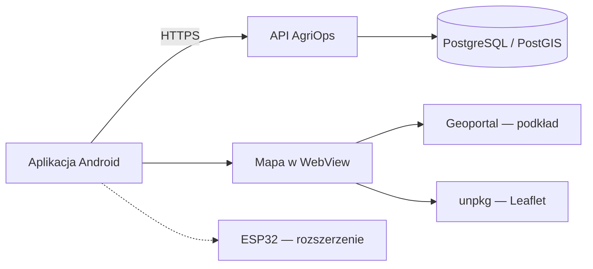

# AgriOps Mobile

Projekt na zajęcia Bezpieczeństwo Aplikacji i Systemów Mobilnych. Poniżej znajduje się karta projektu i aktualny stan aplikacji.

## Informacje o projekcie

| Pole | Wartość |
| --- | --- |
| Nazwa aplikacji | AgriOps Mobile |
| Zespół | Wojciech Kierat, Błażej Sztefka |
| Platforma | Android; telefon właściciela i tablet w ciągniku |
| Technologia aplikacji | React Native, TypeScript, Expo z własnym buildem deweloperskim |
| Backend | Istniejące API AgriOps w ASP.NET Core; aplikacja łączy się z nim bezpośrednio przez HTTPS |
| Baza danych | PostgreSQL / PostGIS po stronie AgriOps |
| Repozytorium | [Kieratw/agriops-mobile](https://github.com/Kieratw/agriops-mobile) |

## 1. Koncepcja aplikacji

AgriOps Mobile służy do przeglądania pól, zapisywania zdjęć z lokalizacją i rejestrowania punktów pobrania próbek gleby. Właściciel planuje proste prace terenowe, a tablet w ciągniku pokazuje przypisane zadania i pozwala zgłosić ich wykonanie. Dane trafiają bezpośrednio do API AgriOps przez HTTPS; ręczny zapis próbek pozwala korzystać z aplikacji bez gotowego ESP32.

Aplikacja jest przeznaczona dla właściciela gospodarstwa i osoby korzystającej z przypisanego terminala w ciągniku. Projekt nie obejmuje ewidencji pracowników.

MVP obejmuje jeden rodzaj zlecenia: uprawę gleby, np. przejazd agregatem. Właściciel wybiera pole, termin, ciągnik i narzędzie. Terminal rejestruje rozpoczęcie, zakończenie oraz raport z czasem, powierzchnią i ewentualną uwagą; właściciel zatwierdza wykonanie.

ESP32 jest rozszerzeniem po uruchomieniu ręcznej rejestracji próbek. Punkt GPS oznacza miejsce pobrania próbki, a wynik badania gleby jest osobną daną.

Do obserwacji pola można będzie zrobić nowe zdjęcie kamerą albo wybrać istniejące z galerii. Lokalizacja obserwacji będzie zapisywana osobno, z rozróżnieniem aktualnego GPS i punktu wskazanego ręcznie.

## 2. Role użytkowników

| Rola | Co może | Czego nie może |
| --- | --- | --- |
| Właściciel | Przeglądać dane swoich gospodarstw, planować zlecenia, parować i odłączać terminale, przeglądać zdjęcia i próbki oraz zatwierdzać raporty prac. | Odczytywać ani zmieniać danych cudzych gospodarstw. |
| Terminal ciągnika | Po sparowaniu odczytywać przydzielone pola i zadania, rejestrować przebieg pracy oraz dodawać zdjęcia, lokalizacje i punkty próbek w dozwolonym zakresie. | Zarządzać dostępem, tworzyć i edytować pól, zatwierdzać własnych raportów ani pobierać danych innych gospodarstw lub nieprzydzielonych zadań. |

Terminal otrzymuje własną sesję, którą właściciel może odwołać. Zakres dostępu sprawdza serwer przy każdym żądaniu. Parowanie odbywa się na karcie ciągnika w webie.

## 3. Dane i ich klasyfikacja

| Dane | Źródło | Przechowywanie docelowe | Klasyfikacja | Uzasadnienie |
| --- | --- | --- | --- | --- |
| E-mail i identyfikator konta | Logowanie | Backend; w aplikacji tylko potrzebne dane sesji | Poufne | Pozwalają powiązać dane z użytkownikiem. |
| Tokeny sesji | API AgriOps | Chroniony magazyn systemowy telefonu lub tabletu; backend obsługuje ważność i odwołanie sesji | Poufne | Umożliwiają dostęp do konta lub terminala. |
| Kod QR i sekret próby parowania | Terminal i API AgriOps | Backend oraz chwilowo urządzenia podczas parowania; sekret pozostaje na terminalu i nie trafia do QR | Poufne | Kod wskazuje próbę parowania, a osobny sekret pozwala terminalowi odebrać zatwierdzoną sesję. |
| Pola, uprawy i przypisanie próbek | AgriOps i formularze aplikacji | AgriOps; na urządzeniu tylko dane potrzebne do pracy | Wewnętrzne | Opisują gospodarstwo i jego działalność. |
| Zlecenia i raporty prac | Właściciel i terminal | Backend; lokalnie szkic niezakończonej pracy | Wewnętrzne | Zawierają terminy, maszyny i historię wykonania. |
| Zdjęcia i dokładna lokalizacja | Kamera, galeria, GPS lub punkt wskazany na mapie | AgriOps; czasowo prywatna pamięć aplikacji przed wysłaniem | Szczególnie wrażliwe | Mogą ujawnić miejsce pobytu, otoczenie i przebieg pracy. |
| Podkład mapowy | Geoportal | Usługa zewnętrzna i bieżący widok mapy | Publiczne | Publicznie dostępne zdjęcia lotnicze. |

Hasło służy do logowania i nie jest zapisywane lokalnie. Biometrię obsługuje Android; aplikacja nie przechowuje odcisków palców ani wzorca twarzy. Lokalny szkic wymaga ochrony danych i usunięcia po wysłaniu lub świadomym odrzuceniu.

## 4. Mapowanie na umowę o powierzchni ataku

W tabeli opisano zakres docelowy do MVP. Obecny stan implementacji znajduje się w sekcji „Stan aplikacji”.

| Wymagana funkcja | Realizacja w aplikacji | Termin |
| --- | --- | --- |
| Logowanie z tokenami i co najmniej dwie role | Sesja właściciela oraz osobna sesja terminala ciągnika. Właściciel wyświetla QR w webie i zatwierdza próbę zgłoszoną przez telefon. Kontrola ról, gospodarstwa i przydzielonych zadań po stronie backendu. | Z3–Z5 |
| Własny backend/API | Własne API AgriOps w ASP.NET Core; rozszerzenie o sesje terminali, parowanie i funkcje mobilnego MVP. | Z3–Z5 |
| Lokalne przechowywanie danych wrażliwych | Token sesji w magazynie systemowym przez expo-secure-store; usunięcie przy wylogowaniu. Ochrona lokalnego szkicu raportu i próbki. | Z4 |
| Co najmniej trzy uprawnienia systemowe | Kamera do zdjęć i QR, lokalizacja do oznaczania punktów, powiadomienia do przypomnienia o dokończeniu szkicu próbki. Pokaz na Androidzie 13 lub nowszym; obsługa odmowy każdej zgody. | Z4–Z5 |
| Deep link | Zweryfikowane Android App Links oparte na HTTPS otwierają potwierdzenie parowania QR lub szczegóły pola. Aplikacja sprawdza domenę, ścieżkę i parametry, a backend sprawdza sesję oraz uprawnienia. | Z5 |
| WebView lub treści zewnętrzne | Mapa Leaflet w WebView z publicznym podkładem Geoportalu. Ograniczone źródła i nawigacja; bez przekazywania sesji API do strony. | Z2, sprawdzenie zabezpieczeń do Z5 |
| Biometria jako opcja odblokowania | Opcjonalne odblokowanie istniejącej sesji mechanizmem Androida; obsługa urządzenia bez biometrii i ponownego logowania. | Z5 |

Galeria będzie dostępna przez systemowy Photo Picker, który udostępnia aplikacji wybrane zdjęcia. Taki wybór nie wymaga szerokiego dostępu do biblioteki, dlatego jest dodatkową funkcją, a trzecim uprawnieniem w karcie pozostają powiadomienia. Podstawa: [Android Photo Picker](https://developer.android.com/training/data-storage/shared/photo-picker).

### Zabezpieczenie parowania QR

1. Właściciel w webie otwiera kartę aktywnego ciągnika i w sekcji **Przypisane urządzenia** wybiera **Sparuj terminal**. Kod jest ważny przez 5 minut.
2. Telefon skanuje QR systemowym aparatem. AgriOps Mobile wyświetla nazwę gospodarstwa i ciągnika. Po kliknięciu **Połącz jako terminal** telefon wyświetla sześciocyfrowy numer.
3. Właściciel porównuje numer z wyświetlonym w webie i klika **Zatwierdź urządzenie**. Telefon odbiera sesję, zapisuje ją w Android Keystore przez Expo SecureStore i wyświetla zaplanowane operacje przypisane do ciągnika.
4. **Odłącz terminal** na karcie ciągnika odbiera dostęp przy kolejnym żądaniu telefonu. Zatwierdzenie nowego terminala również kończy poprzednie aktywne przypisanie typu Terminal.

Backend przechowuje skróty kodu, sekretu próby i tokenu sesji. Kod QR jest we fragmencie linku HTTPS, który nie trafia do żądania strony. Weryfikacja sesji odbywa się przy każdym pobraniu zleceń.

Przed odbiorem na telefonie zastosuj migrację `AddTerminalPairings` i zbuduj nową aplikację Android. Ustaw ten sam adres HTTPS w `EXPO_PUBLIC_APP_ORIGIN` (Android) i `TERMINAL_APP_ORIGIN` (web, domyślnie `https://agriops.pl`). `EXPO_PUBLIC_API_URL` musi wskazywać API HTTPS tego samego środowiska. Na domenie web ustaw `TERMINAL_ANDROID_CERT_FINGERPRINTS` na odcisk SHA-256 certyfikatu podpisującego instalowany APK, z dwukropkami między bajtami. Kilka odcisków oddziel przecinkami. Web opublikuje deklarację pod `/.well-known/assetlinks.json`. Dla wydania z Google Play użyj certyfikatu podpisywania aplikacji z Play Console.

Sprawdzimy:

- kod wygasły, zmieniony, użyty ponownie i dwa równoczesne odbiory sesji;
- brak zalogowanego właściciela, brak któregoś potwierdzenia i brak sekretu terminala;
- próbę przypisania ciągnika z cudzego gospodarstwa i zmianę identyfikatorów w żądaniu;
- QR z obcą domeną, inną ścieżką lub dodatkowymi parametrami oraz błędne powiązanie domeny z aplikacją;
- odwołanie sesji terminala i odmowę dalszego dostępu do danych.

Podstawy rozwiązania: [Android App Links](https://developer.android.com/training/app-links/about), [OWASP — zarządzanie sesją](https://cheatsheetseries.owasp.org/cheatsheets/Session_Management_Cheat_Sheet.html) i autoryzacja urządzeń w [RFC 8628](https://www.rfc-editor.org/rfc/rfc8628.html). Dokumenty te są punktem odniesienia przy projektowaniu własnego przepływu parowania.

## 5. Architektura

| Komponent | Technologia | Odpowiedzialność i połączenia |
| --- | --- | --- |
| Aplikacja mobilna | React Native, TypeScript, Expo | Interfejs właściciela i terminala, kamera, wybór zdjęć z galerii, lokalizacja, lokalna sesja; bezpośrednie połączenie HTTPS z API AgriOps. |
| Istniejące API AgriOps | ASP.NET Core | Dane gospodarstw, logowanie, sesje i reguły dostępu; komunikacja z bazą danych. Sesje terminali, parowanie i mobilne zlecenia są planowanym rozszerzeniem tego backendu. |
| Baza danych | PostgreSQL / PostGIS | Dane gospodarstw, pól, lokalizacji i zapisów terenowych; dostęp przez backend. |
| Mapa w WebView | Leaflet, Geoportal i CDN unpkg | Publiczny podkład mapowy i biblioteka mapy; niezależne od sesji API. |
| ESP32 — rozszerzenie | Do ustalenia po MVP | Komunikacja z aplikacją przy pobieraniu próbek. |

Szkic docelowy:

Szczegółowy [diagram przepływu danych (DFD)](docs/threat-model/README.md)
pokazuje granice zaufania i bezpośrednią komunikację z API AgriOps. Zawiera
edytowalne źródło Mermaid oraz eksporty PNG i SVG.

[Model zagrożeń v1](docs/threat-model/threat-model-v1.md) zawiera 10 scenariuszy
STRIDE, ocenę ryzyka, decyzje, wymagania i plan weryfikacji.

Obecny szkielet korzysta bezpośrednio z istniejącego API AgriOps i jego sesji opartej na ciasteczkach. Ten sam backend zostanie rozszerzony o tokeny terminala, parowanie QR i pozostałe funkcje mobilne. Dane gospodarstw pozostają po stronie AgriOps, a dostęp do nich wymaga sprawdzenia gospodarstwa i uprawnień na serwerze.

## 6. Podział pracy w zespole

| Osoba | Główna odpowiedzialność | Obszary bezpieczeństwa |
| --- | --- | --- |
| Wojciech Kierat | Główny szkielet aplikacji, logowanie i sesje, integracja z API, rozszerzenia backendu AgriOps, parowanie QR i obsługa zleceń właściciel–ciągnik. | MASVS-AUTH, MASVS-NETWORK; autoryzacja i izolacja gospodarstw w API. |
| Błażej Sztefka | Moduł terenowy: mapa, zdjęcia z kamery i galerii, GPS, punkty próbek, uprawnienia i deep link. Testy funkcjonalne i bezpieczeństwa, dokumentacja MASVS oraz dowody z weryfikacji. | MASVS-STORAGE, MASVS-PLATFORM, MASVS-PRIVACY. |
| Wspólnie | Architektura, model zagrożeń, przegląd kodu drugiej osoby, integracja modułów i prezentacja. | MASVS-CRYPTO, MASVS-CODE, MASVS-RESILIENCE i końcowa checklista. |

## 7. Plan dojścia do MVP

| Zajęcia | Planowany rezultat |
| --- | --- |
| Z2 | Repozytorium z dostępem prowadzącego, karta projektu w README, budujący i uruchamiający się szkielet oraz szkic architektury. Właściciel ma formularz logowania i listę pól z API, terminal ma mapę. |
| Z3 | Rozszerzenie API AgriOps o sesje i role terminali. Pierwsze zlecenie uprawy gleby utworzone przez właściciela i widoczne dla przypisanego ciągnika. Wstępny diagram przepływu danych i lista zagrożeń. |
| Z4 | Zdjęcie z kamery lub galerii, lokalizacja i punkt próbki zapisują się przez API. Terminal rejestruje rozpoczęcie, zakończenie i raport pracy. Chroniony magazyn sesji oraz zachowanie szkicu po restarcie i utracie połączenia. |
| Z5 — MVP | Pełny scenariusz zlecenie → wykonanie → zatwierdzenie. Działają pozycje umowy: tokeny, role, QR ze zweryfikowanym App Linkiem i potwierdzeniami, trzy uprawnienia, linki do pól, WebView i opcjonalne odblokowanie biometrią. Model zagrożeń v1. |

Przy braku internetu MVP zachowuje lokalny szkic i umożliwia jego ręczne wysłanie po odzyskaniu połączenia, z ochroną przed powtórnym zapisem. Mapy offline, ciągłe śledzenie maszyny, automatyczne propozycje zabiegów i integracja z ESP32 pozostają poza MVP.

## 8. Największe ryzyka

| Ryzyko | Dlaczego jest istotne | Co sprawdzimy |
| --- | --- | --- |
| Dostęp do cudzych pól lub zadań przez zmianę identyfikatora w żądaniu albo deep linku | Błąd autoryzacji może ujawnić lub zmienić dane innego gospodarstwa. | Żądania z konta innego gospodarstwa, terminala bez przydziału oraz po odwołaniu sesji. |
| Przejęcie sesji lub kodu QR | Skradziony token albo ponowne użycie QR może dać dostęp do terminala. | Jednorazowość i wygaśnięcie kodu, odwołanie sesji, wylogowanie i zawartość pamięci urządzenia. |
| Wyciek zdjęć i dokładnej lokalizacji | Dane mogą trafić do logów, kopii zapasowej, obcej strony lub pozostać w lokalnym szkicu. | Magazyn i usuwanie danych, zakres WebView, zawartość logów i ruch sieciowy. |

### Wykorzystanie tematów z prezentacji

| Temat | Zastosowanie w projekcie |
| --- | --- |
| Model zagrożeń i przepływ danych | Rozpisanie drogi zdjęcia, lokalizacji i sesji od urządzenia do AgriOps oraz wskazanie granic zaufania. |
| Uwierzytelnianie i autoryzacja | Próby dostępu do cudzych pól, obejścia przydziału zadań, ponownego użycia QR i użycia odwołanej sesji. |
| Przechowywanie i kryptografia | Sprawdzenie ochrony tokenów, lokalnych szkiców, usuwania danych po wylogowaniu i zawartości kopii zapasowej. |
| Platforma i prywatność | Odmowa kamery, lokalizacji i powiadomień; anulowanie wyboru zdjęcia; walidacja deep linków i ograniczenie WebView. |
| Sieć i walidacja danych | HTTPS, walidacja załączników i danych GPS, kontrola dostępu do plików oraz ograniczanie prób logowania i parowania. |
| Łańcuch dostaw i analiza aplikacji | Przegląd zależności oraz otwarcie APK w jadx w celu sprawdzenia, czy nie zawiera sekretów lub poufnych danych. |

Wyniki będą zbierane jako dowody do checklisty MASVS. Analiza APK i modyfikacja danych wejściowych służą do sprawdzenia zabezpieczeń; aplikacja ma pozostać bezpieczna także wtedy, gdy klient zostanie zmodyfikowany.

### Aktualizacje względem pierwotnej karty

Rola pracownika została zastąpiona terminalem przypisanym do ciągnika. Zachowano wybór zdjęć z galerii, a trzecim uprawnieniem wymagającym zgody są powiadomienia. WebView służy do mapy. Zweryfikowane App Links obsłużą parowanie QR i szczegóły pola. Kartę w tej wersji należy przedstawić prowadzącemu; jego akceptacja nie jest jeszcze odnotowana.

## Stan aplikacji

Szkielet zawiera wybór trybu, formularz logowania do istniejącego AgriOps, wybór gospodarstwa, pobranie listy pól i mapę Geoportalu. Pełne role, mobilne rozszerzenia API, tokeny terminali, parowanie QR, weryfikacja App Links, kamera i galeria, próbki oraz zlecenia nie są jeszcze zaimplementowane.

Szkielet został zbudowany i uruchomiony na emulatorze. Sprawdzono ekran wyboru, formularz i mapę. Logowanie prawdziwym kontem oraz odczyt prywatnych gospodarstw i pól wymagają jeszcze sprawdzenia na urządzeniu.

Repozytorium jest publiczne. Na Z2 należy przekazać jego adres prowadzącemu i zapoznać się z [wprowadzeniem do OWASP MASVS](https://mas.owasp.org/MASVS/).

Materiały: [OWASP MASVS](https://mas.owasp.org/MASVS/). Mapa: Leaflet 1.9.4 i podkład GUGiK / Geoportal.gov.pl.
