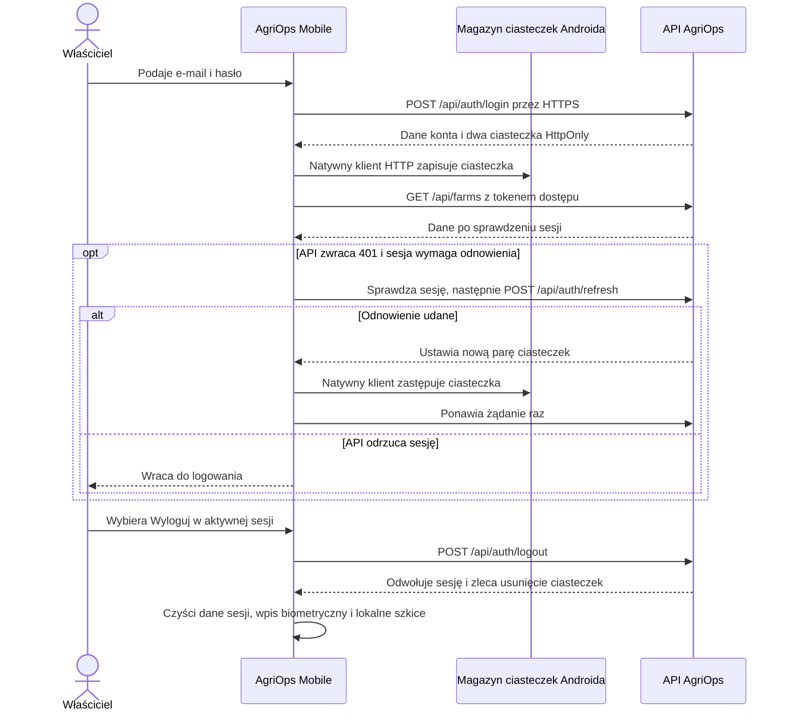

# Raport: logowanie i sesje — AgriOps Mobile

BAiSM · Zajęcia 6 · Android (React Native + Expo). Stan według lokalnego kodu aplikacji i API. Odnośniki do linii obejmują także bieżące zmiany robocze. Zachowanie na urządzeniu wymaga potwierdzenia.

## 1.1 Elementy sesji

### Logowanie właściciela

Ciasteczka właściciela obsługuje **natywny klient HTTP aplikacji**. SecureStore przechowuje wpis biometryczny właściciela oraz osobne poświadczenie terminala. Terminal odbiera token po zatwierdzeniu QR przez właściciela i wysyła go w nagłówku `Authorization: Terminal …`. [Klient właściciela](../../mobile/src/services/agriOpsApi.ts#L293) · [Zapis tokenu terminala](../../mobile/src/screens/TerminalScreen.tsx#L156) · [Żądanie terminala](../../mobile/src/services/terminalApi.ts#L128)

| Element | Powstaje | Gdzie jest | Ważność | Jak wygasa lub jest odwoływany | Ryzyko i dowód |
| --- | --- | --- | --- | --- | --- |
| Hasło | Użytkownik | Chwilowo w formularzu, skrót w bazie | Do zmiany lub resetu | Zmiana hasła i odwołanie sesji | Przejęte hasło pozwala się zalogować. [Formularz](../../mobile/src/screens/OwnerScreen.tsx#L81) · [Hasło w API][haslo] |
| Token dostępu | API | Ciasteczko HttpOnly w kliencie Androida | 15 min na JWT | Wygaśnięcie albo odwołanie sesji | Ważny token daje dostęp do aktywnej sesji. [Konfiguracja API][konfiguracja] · [Weryfikacja sesji][jwt] |
| Token odświeżania | API | Ciasteczko HttpOnly, skrót w bazie | 30 dni, termin przesuwany przy rotacji | Rotacja lub odwołanie sesji | Brak bezwzględnego końca odnawianej sesji. [Sesje API][sesje] |
| Wpis biometryczny | Aplikacja po włączeniu opcji | SecureStore z `requireAuthentication` | Do usunięcia wpisu lub utraty dostępu do niego | Wylogowanie, wyłączenie opcji lub odrzucenie sesji przy wznowieniu | Biometria chroni identyfikator konta. Ciasteczka są przechowywane osobno. [Wznowienie](../../mobile/src/hooks/useOwnerSession.ts#L216) · [SecureStore](../../mobile/src/services/secureDrafts.ts#L100) |
| Kod QR i sekret parowania | API wydaje kod, terminal generuje sekret | Kod trafia do QR, sekret do SecureStore, skróty do bazy | 5 min dla próby parowania | Zakończenie, anulowanie lub upływ czasu | Sam kod nie wystarcza do odebrania sesji. [Parowanie na telefonie](../../mobile/src/screens/TerminalScreen.tsx#L415) · [Parowanie w API][parowanie] |
| Token terminala | API po zatwierdzeniu parowania | SecureStore, skrót w bazie | Gdy przypisanie terminala jest aktywne | Odłączenie urządzenia w API | Lokalne odłączenie usuwa zapis na telefonie. Odwołanie na serwerze wymaga zakończenia przypisania. [Odłączenie lokalne](../../mobile/src/screens/TerminalScreen.tsx#L456) · [Walidacja tokenu][terminal] |

## 1.2 Scenariusze

Oczekiwania oparto na [OWASP Session Management][owasp-sesje] i [OWASP MASVS-AUTH-2][owasp-bio].

| Scenariusz | Oczekiwanie | Stan według kodu i dowód |
| --- | --- | --- |
| Wylogowanie | Zamknąć sesję i usunąć lokalne dane. | Aplikacja sprząta dane lokalne także po błędzie sieci. Odwołanie na serwerze zależy od dostarczenia żądania z aktualnym tokenem odświeżania. [Aplikacja](../../mobile/src/hooks/useOwnerSession.ts#L269) · [API][wylogowanie] |
| Zgubiony telefon | Odwołać dostęp z innego urządzenia. | Właściciel może zakończyć wszystkie sesje konta. Terminal można odłączyć w ustawieniach maszyny. [Sesje konta][wylogowanie] · [Odłączenie terminala][odlaczenie] |
| Zmiana hasła | Zakończyć poprzednie sesje konta. | Backend odwołuje sesje właściciela. Terminal korzysta z osobnego przypisania. [Zmiana hasła][haslo] · [Walidacja terminala][terminal] |
| Wygaśnięcie tokenu | Odnowić dostęp lub poprosić o hasło. | Właściciel po 401 może ponowić żądanie po odnowieniu sesji. Terminal usuwa token, gdy pobranie pulpitu zwraca 401. [Właściciel](../../mobile/src/services/agriOpsApi.ts#L227) · [Terminal](../../mobile/src/screens/TerminalScreen.tsx#L224) |
| Reinstalacja | Wymagać logowania lub ponownego parowania. | Konfiguracja Androida wyłącza kopie danych aplikacji. Brak przywróconej sesji wymaga testu APK. [Konfiguracja](../../mobile/app.json#L24) |
| Przechwycony token | Odrzucać odwołane poświadczenia. | API sprawdza stan sesji. Ponowne użycie zużytego tokenu odświeżania zamyka jego rodzinę. Token terminala traci dostęp po zakończeniu przypisania. [Sesje API][sesje] · [Terminal][terminal] |
| Zewnętrzny dostawca | Nie dotyczy. | Właściciel loguje się e-mailem i hasłem AgriOps. [Logowanie](../../mobile/src/services/agriOpsApi.ts#L374) |
| Biometria | Potwierdzić tożsamość przed odblokowaniem. | Odblokowanie otwartego widoku jest lokalne. Po restarcie aplikacja po biometrii odświeża sesję i sprawdza zgodność konta. [Blokada i wznowienie](../../mobile/src/hooks/useOwnerSession.ts#L216) |

## 1.3 Polityka sesji

| Parametr | Obecnie | Docelowo |
| --- | --- | --- |
| Token dostępu | 15 min. [Konfiguracja API][konfiguracja] | Zachować. |
| Token odświeżania | 30 dni z przesuwaniem terminu. [Sesje API][sesje] | Maks. 30 dni od logowania. |
| Bezczynność | Opcjonalna blokada ekranu po 1 min w tle. Sesja na serwerze nadal obowiązuje. [Blokada](../../mobile/src/hooks/useOwnerSession.ts#L50) | Zachować blokadę. Dodać wygaśnięcie sesji po 30 min bezczynności. |
| Błędne logowanie | 10 błędów → 15 min blokady. Limit 5 żądań/min na IP. [Hasło][haslo] · [Limit IP][limit] | Zachować. |
| Ponowne potwierdzenie | Biometria przy odblokowaniu, aktualne hasło przy zmianie hasła i usunięciu konta w API. [Biometria](../../mobile/src/hooks/useOwnerSession.ts#L249) · [Hasło][haslo] | Zachować. Po utracie dostępu do wpisu biometrycznego wymagać hasła. |
| Link resetu hasła | API obsługuje jednorazowy link ważny 1 godz. [Reset][reset] | Zachować. |
| Aktywne sesje | Do 20 sesji właściciela na konto i jedno aktywne przypisanie terminala na ciągnik w przepływie parowania. [Konfiguracja API][konfiguracja] · [Parowanie][parowanie] | Zachować. |
| Ważność tokenu terminala | Zależy od aktywnego przypisania. [Walidacja terminala][terminal] | Maks. 30 dni lub do odłączenia urządzenia. |

## 1.4 Decyzje

- **Ograniczyć czas sesji właściciela.** Zakończyć ją po 30 min bezczynności albo najpóźniej po 30 dniach od logowania. Serwer egzekwuje oba limity także przy odnowieniu. [Sesje API][sesje] · [OWASP Session Management][owasp-sesje]
- **Rozróżnić lokalne wylogowanie od odwołania sesji.** Po utracie sieci zamknąć widok i przekazać użytkownikowi, czy serwer potwierdził zakończenie sesji. [Wylogowanie w aplikacji](../../mobile/src/hooks/useOwnerSession.ts#L269) · [OWASP Session Management][owasp-sesje]
- **Umożliwić odwołanie sesji zgubionego telefonu.** Dodać wybór pojedynczej sesji właściciela w ustawieniach konta. Obecna funkcja odwołuje wszystkie sesje. [Wylogowanie w API][wylogowanie] · [OWASP Session Management][owasp-sesje]
- **Zweryfikować blokadę na Androidzie.** Sprawdzić restart, zmianę zapisanej biometrii i powrót do logowania hasłem, gdy wpisu nie da się odczytać. [Wznowienie](../../mobile/src/hooks/useOwnerSession.ts#L216) · [OWASP MASVS-AUTH-2][owasp-bio]
- **Ograniczyć ważność poświadczenia terminala.** Dodać limit 30 dni i sprawdzić, czy po wygaśnięciu oraz po odłączeniu aplikacja wymaga ponownego parowania. [Walidacja terminala][terminal] · [OWASP Session Management][owasp-sesje]

**Do zajęć 7** — wdrożyć uzgodnione zmiany, zapisać commity, ponownie przejść scenariusze na Androidzie i spisać endpointy aplikacji.

[haslo]: ../../../agriops-backend/AgriOps.Infrastructure/Auth/AuthService.cs#L120
[reset]: ../../../agriops-backend/AgriOps.Infrastructure/Auth/AuthService.cs#L243
[konfiguracja]: ../../../agriops-backend/AgriOps.Api/appsettings.json#L11
[limit]: ../../../agriops-backend/AgriOps.Api/Program.cs#L76
[jwt]: ../../../agriops-backend/AgriOps.Api/Program.cs#L347
[sesje]: ../../../agriops-backend/AgriOps.Infrastructure/Auth/UserSessionService.cs#L75
[wylogowanie]: ../../../agriops-backend/AgriOps.Api/Controllers/AuthController.cs#L195
[parowanie]: ../../../agriops-backend/AgriOps.Infrastructure/Machines/TerminalPairingService.cs#L38
[terminal]: ../../../agriops-backend/AgriOps.Infrastructure/Machines/TerminalPairingService.cs#L207
[odlaczenie]: ../../../agriops-backend/AgriOps.Infrastructure/Machines/MachineServices.cs#L222
[owasp-sesje]: https://cheatsheetseries.owasp.org/cheatsheets/Session_Management_Cheat_Sheet.html
[owasp-bio]: https://mas.owasp.org/MASVS/controls/MASVS-AUTH-2/
