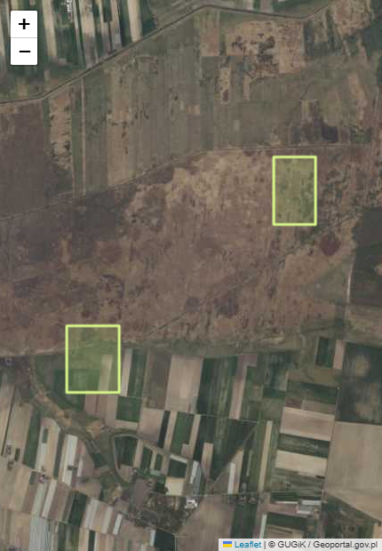
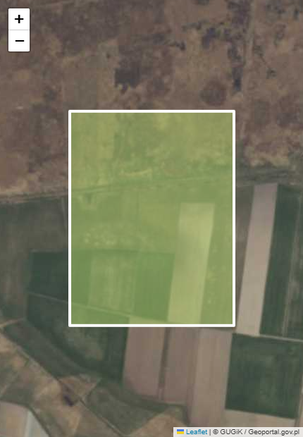

# Weryfikacja szkieletu i mapy pól

Sprawdzenie z 30.10.2026.

| Sprawdzenie | Wynik |
| --- | --- |
| npm run typecheck | Poprawnie. |
| npm test | 14 testów, 14 zaliczonych. |
| Android assembleDebug, x86_64 | BUILD SUCCESSFUL, 32 s. |
| Expo export Android, JavaScript/Hermes | Poprawnie, 643 moduły. |
| Mapa dwóch pól testowych w Leaflet 1.9.4 | Granice Polygon/MultiPolygon są widoczne; widok obejmuje oba pola. |
| Wybranie jednego pola | Przybliżenie zmienia się z poziomu 14 na 16 i obejmuje wybrane pole. |
| Konsola przeglądarki mapy | Bez błędów i ostrzeżeń. |

Testy obejmują odrzucenie odpowiedzi z cudzym farmId, statusy 401 i 403,
żądania z sesją cookies i Origin, pustą odpowiedź przy wylogowaniu,
brak sieci, parsowanie geometrii oraz nazwy zawierające HTML.

Mapa była sprawdzana na jawnie testowych granicach. To test renderowania i
przybliżania, a nie potwierdzenie dostępu do prawdziwego gospodarstwa.
Udane logowanie i pobranie prywatnych pól na urządzeniu pozostają do sprawdzenia.

