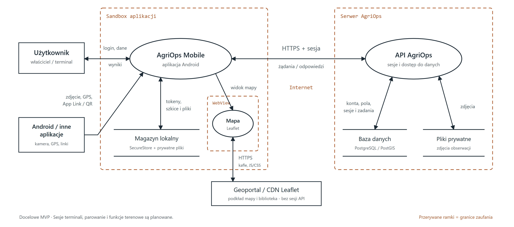
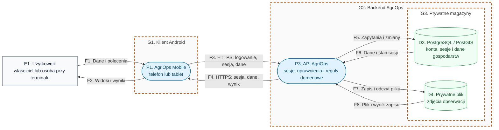
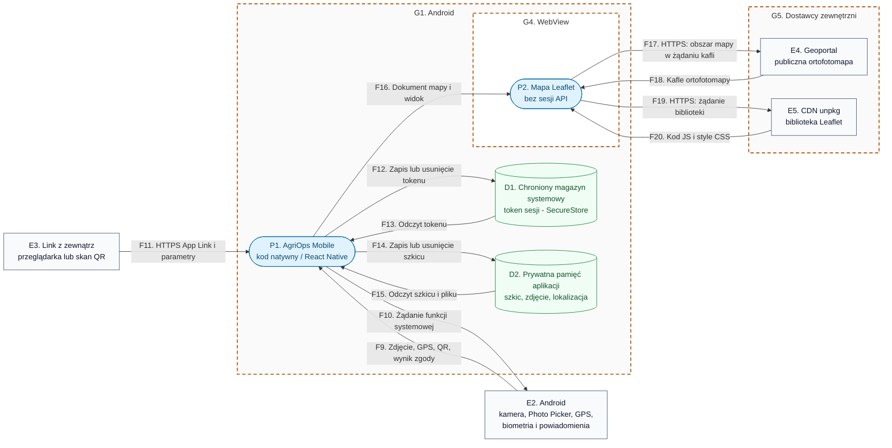

# AgriOps Mobile - diagram przepływu danych (DFD)

Wersja robocza v2, 23.10.2026. Zakres: aplikacja Android dla właściciela
gospodarstwa i terminala w ciągniku oraz jej droga do danych AgriOps.

**To model docelowego MVP.** Aplikacja łączy się bezpośrednio z API AgriOps
przez HTTPS. Sesje terminali, parowanie, SecureStore, zdjęcia i szkice są
planowanymi rozszerzeniami. Obecny szkielet używa sesji opartej na cookies.

Źródłem szczegółowych diagramów są bloki Mermaid w tym pliku. Obok znajdują się eksporty
PNG do oddania lub wklejenia do sprawozdania oraz SVG do powiększania.

## Diagram skrótowy

Skrót DFD z procesami, magazynami danych i granicami zaufania.
Edytowalnym źródłem tego widoku jest [plik SVG](dfd-overview.svg).

[PNG (3840 × 1700)](dfd-overview.png) | [SVG](dfd-overview.svg)

## 1. Droga aplikacja - API AgriOps - dane

Aplikacja zna publiczny adres API AgriOps. Ten sam backend obsługuje logowanie,
sprawdza sesję i dostęp do gospodarstwa oraz wykonuje operacje domenowe.
Telefon i tablet nie mają połączenia z bazą danych ani dostępu do katalogu
plików serwera. Zdjęcia przesyłają i pobierają przez API z kontrolą dostępu.

Telefon właściciela i tablet uruchamiają osobne instancje procesu P1, z osobnymi
sesjami i magazynami lokalnymi. Wspólny symbol upraszcza diagram; nie oznacza
wspólnej sesji ani równych uprawnień. Wybór ekranu Właściciel / Ciągnik nie
nadaje uprawnień.

[PNG](dfd-system.png) | [SVG](dfd-system.svg)

### Dane w przepływach

| ID | Kierunek | Przenoszone dane |
| --- | --- | --- |
| F1-F2 | Użytkownik ↔ P1 | E-mail i hasło podczas logowania; wybór gospodarstwa, pola i zadania; zatwierdzenie parowania; formularze obserwacji, próbek i raportów; widoki wynikowe. |
| F3 | P1 → P3 | Dane logowania albo sesja właściciela/terminala; żądania pól i zadań; zdjęcia, lokalizacja, próbki, raporty; rozpoczęcie, zatwierdzenie i odbiór parowania. Utworzenie próby parowania przed uzyskaniem sesji terminala wymaga osobnych ograniczeń i limitów. |
| F4 | P3 → P1 | Wynik logowania, dane sesji, kod do QR i osobny sekret próby dla terminala; dane dostępne dla danej sesji; potwierdzenia i błędy. Sekret próby nie trafia do QR. |
| F5-F6 | P3 ↔ D3 | Konta, sesje, członkostwa, pola i geometrie; docelowo przypisania terminali, skróty kodu i sekretu parowania, dane zleceń, obserwacji, próbek, raportów i metadane zdjęć. Hasło nie jest zapisywane w postaci jawnej. |
| F7-F8 | P3 ↔ D4 | Prywatne zdjęcia oraz wynik ich zapisu/odczytu. Wysłanie i pobranie z urządzenia przebiega przez P3 z kontrolą dostępu do gospodarstwa i konkretnego zasobu. |

### Założenia bezpieczeństwa API

| Obszar | Założenie |
| --- | --- |
| Adres w aplikacji | `EXPO_PUBLIC_API_URL` wskazuje API AgriOps. Adres jest publiczną konfiguracją; aplikacja nie zawiera sekretów serwera ani danych dostępowych do bazy. |
| Granica sieciowa | Żądania i odpowiedzi aplikacji korzystają z HTTPS. Baza i prywatne pliki są dostępne dla backendu z odpowiednimi uprawnieniami. |
| Sesje | API weryfikuje ważność sesji po stronie serwera. Istniejące mechanizmy kont użytkowników trzeba zachować; osobne, odwoływalne sesje terminali i mobilny kontrakt tokenów wymagają implementacji. |
| Izolacja gospodarstw | `farmId`, `fieldId`, `taskId` i rola z żądania są danymi wejściowymi. Serwer sprawdza członkostwo właściciela albo przypisanie terminala i zadania. Ograniczona rola terminala jest planowana. |
| Dane wejściowe | API waliduje formularze, identyfikatory i załączniki oraz stosuje limity żądań i rozmiarów. Istniejące kontrole trzeba zachować i objąć nimi nowe endpointy mobilne. |
| Pliki i diagnostyka | Zdjęcia wymagają kontroli dostępu przy zapisie i odczycie. Hasła, tokeny, kody i sekrety parowania nie trafiają do logów. |

Tabela określa wymagania modelu; nie jest potwierdzeniem gotowości nowych
funkcji ani wynikiem audytu. Zakres istniejących mechanizmów opisuje
[przegląd backendu i bazy](../../../agriops-docs/docs/security/backend-database-security-review.md).

## 2. Wnętrze urządzenia i usługi zewnętrzne

To rozwinięcie P1 i granicy G1 z pierwszego diagramu. Pokazuje lokalne dane,
wejścia z Androida i osobny kontekst WebView. Połączenia P1 z API pozostają
takie jak F3-F4. Urządzenie, sieć, dane z innych aplikacji i pobrany kod
zewnętrzny wymagają własnej oceny zaufania.

[PNG](dfd-device.png) | [SVG](dfd-device.svg)

### Dane lokalne i wejścia z zewnątrz

| ID | Znaczenie i ograniczenie |
| --- | --- |
| F9-F10 | Zdjęcie z kamery lub wybrane przez Photo Picker, lokalizacja GPS lub wskazana ręcznie, skan QR, wynik systemowego odblokowania i obsługa przypomnienia. Aplikacja nie otrzymuje wzorca biometrii. Funkcje i obsługa odmowy zgody są planowane. |
| F11 | Planowany zweryfikowany Android App Link: potwierdzenie parowania albo szczegóły pola. Parametry są niezaufane. Otwarcie linku nie zatwierdza parowania i nie nadaje dostępu do pola. |
| F12-F13 | Planowany token właściciela albo terminala, chroniony przez magazyn systemowy. Usunięcie lokalnego tokenu i odwołanie sesji na serwerze są osobnymi operacjami. Hasło nie trafia do D1. |
| F14-F15 | Planowany szkic raportu/próbki i plik przed wysłaniem. Zawiera dane wrażliwe; prywatny katalog sam nie przesądza o szyfrowaniu ani ochronie kopii zapasowych. Mechanizm ochrony i usuwania wymaga implementacji. |
| F16 | Dokument mapy i jej widok. Sesja API i sekret parowania nie są przekazywane do WebView. |
| F17-F18 | Publiczne kafle mapy; ich identyfikatory ujawniają dostawcy oglądany obszar oraz adres sieciowy klienta. To oddzielny ruch od połączenia z API AgriOps. |
| F19-F20 | Leaflet JS/CSS z CDN. Pobrany kod wykonuje się w kontekście WebView, dlatego źródło kodu jest istotną granicą zaufania. |

## 3. Legenda i granice zaufania

| Symbol | Element DFD |
| --- | --- |
| Prostokąt `E…` | Encja zewnętrzna względem modelowanego procesu: użytkownik, Android, źródło linku lub dostawca. |
| Zaokrąglony element `P…` | Proces przetwarzający dane. |
| Cylinder `D…` | Magazyn danych. To umowny symbol Mermaid; może oznaczać bazę, magazyn systemowy lub pliki. |
| Strzałka `F…` | Kierunkowy przepływ danych. Dwie strzałki oznaczają osobne żądanie i odpowiedź. |
| Przerywana ramka `G…` | Granica zaufania; nie oznacza automatycznie osobnego fizycznego serwera. |

G1 oddziela aplikację od użytkownika i wejść platformy. Przepływy F3-F4
przechodzą przez niezaufaną sieć między klientem a backendem G2. G3 wyróżnia
uprawnienia dostępu do trwałych danych. G4 oddziela treści WebView od części
natywnej, a G5 wskazuje niezależnych dostawców mapy i kodu. Grupowanie
Geoportalu i CDN nie oznacza wspólnego właściciela lub wspólnych uprawnień.

### Gdzie są dane z karty projektu

| Klasyfikacja projektowa | Dane | Procesy, magazyny i przepływy |
| --- | --- | --- |
| Poufne | E-mail, identyfikator konta, hasło podczas logowania, tokeny sesji, kod i sekret parowania. | P1/P3, D1/D3, F1/F3-F6/F9/F11-F13. Kod QR nie zawiera tokenu sesji ani sekretu próby. |
| Szczególnie wrażliwe | Zdjęcia i dokładna lokalizacja; ich lokalne szkice. | P1/P3, D2/D3/D4, F1-F10/F14-F15. |
| Wewnętrzne | Pola, uprawy, zadania, raporty i przypisania próbek. | P1/P3, D2/D3, F1-F6/F14-F15. |
| Publiczne | Podkład Geoportalu i pliki biblioteki Leaflet. | P2, E4/E5, F17-F20. Publiczna treść mapy nie oznacza, że informacja o oglądanym obszarze jest obojętna dla prywatności. |

Klasyfikacja pochodzi z karty projektu; określenie „szczególnie wrażliwe”
jest kategorią projektu.

### Trzy przepływy do rozpoczęcia STRIDE

| Przepływ | Granica | Pytanie do dalszej analizy |
| --- | --- | --- |
| F3: aplikacja → API | G1 → sieć → G2 | Czy zmodyfikowany klient może użyć cudzej sesji albo zmienić `farmId`, `fieldId` lub `taskId`? |
| F11: link → aplikacja | Źródło zewnętrzne → G1 | Czy podmieniony link lub powtórzone QR może otworzyć cudze dane albo zatwierdzić parowanie bez wymaganych potwierdzeń? |
| F19-F20: WebView ↔ CDN | G4 → sieć → G5 | Co może odczytać lub zmienić kod biblioteki, jeżeli dostawca albo pobrany zasób zostanie przejęty? |

To punkty wejścia do analizy, a nie potwierdzone podatności. Rejestr zagrożeń
STRIDE i ocena ryzyka są osobnym artefaktem.

## 4. Model a obecny kod

| Element | Stan w szkielecie |
| --- | --- |
| P1 i połączenie API | Formularz logowania, wybór gospodarstwa i lista pól. `AgriOpsApi` używa `credentials: 'include'` i łączy się bezpośrednio z istniejącym API. Docelowy mobilny kontrakt tokenów wymaga zaprojektowania. |
| P2, E4 i E5 | Mapa Leaflet w WebView, kafle Geoportalu i zasoby unpkg. WebView ma wyłączone współdzielenie cookies i nie otrzymuje sesji API. |
| P3 i D3 | Istniejący backend i baza AgriOps. Sesje terminali, parowanie i mobilne zlecenia/raporty wymagają rozszerzenia tego backendu. |
| D1, D2 i funkcje terenowe | Planowane; obecna aplikacja nie implementuje SecureStore, trwałych szkiców, parowania ani ról terminala. |
| D4 | Istniejące prywatne przechowywanie plików AgriOps; mobilne przesyłanie zdjęć i jego zakres dostępu wymagają implementacji i weryfikacji. |

Podstawa: [karta projektu](../../README.md),
[klient API](../../mobile/src/services/agriOpsApi.ts),
[konfiguracja adresu](../../mobile/src/config.ts),
[ekran WebView](../../mobile/src/screens/TractorScreen.tsx),
[dokument mapy](../../mobile/src/map/mapHtml.ts).
Notatka o dotychczasowych sprawdzeniach: [weryfikacja](../verification.md).
Układ DFD odpowiada pięciu elementom omawianym w dostarczonej prezentacji
„BAiSM - Zajęcia 2: Modelowanie zagrożeń i architektura” (strony PDF 3-5 i 11-12).
Bezpośrednia komunikacja z API uwzględnia ustalenie projektowe z rozmowy
z 23.10.2026.
